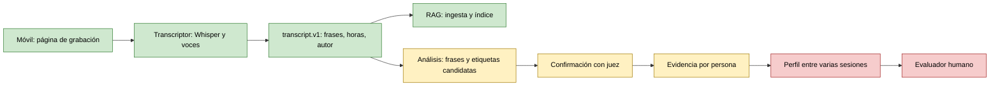
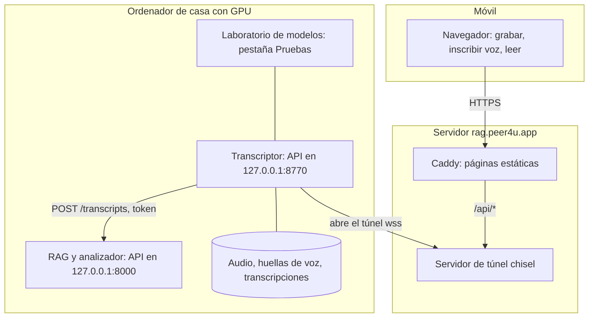
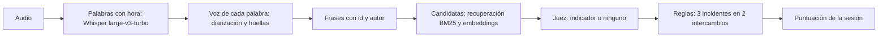

# Estado de la plataforma

Fecha: 2026-11-15. Rama `main` en `65ea93b`. Este documento resume cómo
se está construyendo la plataforma, qué hay hecho, cuánto falta y **cuánta
confianza hay en que cada parte funcione**. Cada porcentaje y cada grado
de certeza apunta a su evidencia; donde no hay medida, lo dice.

Los porcentajes son una estimación del autor del documento sobre el
trabajo de cada fase (código, pruebas y medidas), no una métrica. La
certeza es otra cosa: es lo que **se sabe** de que la fase funciona.

## 1. Qué hace la plataforma y para quién

Alguien pone un móvil en el centro de una mesa y graba una reunión. El
ordenador de casa convierte el audio en frases con hora y autor
(transcriptor), las guarda en un índice de búsqueda (RAG) y compara cada
frase con una rúbrica de 11 competencias y 110 conductas observables. El
objetivo es **ayudar a un evaluador humano formado** a revisar la
conversación con citas literales y tiempos; no es un juez automático de
personas. Esa es la conclusión de la investigación
(`docs/skills/RESEARCH.md`, resumen §1): "Do not sell it as an automatic
judge of personality or leadership".

El mismo núcleo RAG resuelve además el proyecto 42 (búsqueda sobre
documentos y código). Para quién: el dueño del proyecto y, más adelante,
evaluadores (psicólogos o responsables de equipos) que revisen sesiones
con el consentimiento de los participantes.

Estado en una frase: la cadena técnica de la grabación hasta las frases
etiquetadas funciona de punta a punta, pero **ninguna parte que puntúe a
una persona está validada**, y las cifras de audio vienen de habla leída
sintética, no de conversaciones reales.

## 2. Flujo de principio a fin

Verde: hecho. Amarillo: existe pero no es fiable o está incompleto.
Rojo: no existe. El paso "Evidencia por persona" existe como `skills
assess` para una sola sesión; el perfil entre sesiones no existe
(`docs/skills/DESIGN.md` §9).

### Dónde corre cada cosa

El servidor no guarda audio ni transcripciones: sólo sirve las páginas y
pasa las llamadas `/api/*` por el túnel que abre el ordenador de casa
(`docs/DEPLOYMENT.md`, "What runs where"). El RAG no está detrás del
túnel (TR-13).

### Del audio a la evidencia, con lo medido

## 3. Tabla de fases

Escala de certeza, de mayor a menor: medida en datos reales; medida en
corpus públicos; sólo sintética; sin medir.

| # | Fase | Estado | % | Certeza | Evidencia | Riesgo principal | Siguiente paso |
|---|---|---|---|---|---|---|---|
| 1 | Grabación y transcripción | hecho | ~85 | media-baja: sintética | `docs/skills/AUDIO.md` §2; `docs/transcriber/ARCHITECTURE.md` | WER 5,4 % es habla leída, sin solape; en conversación real no hay texto de referencia | #19: reunión real con consentimiento y corrección a mano |
| 2 | Diarización y persona de cada frase | hecho | ~80 | media: sintética y una reunión pública | `docs/transcriber/IDENTIFICATION.md` §3.2; `LAB.md` §13.4 | Voces y micrófonos distintos en el corpus de prueba; en casa todas las voces pasan por un móvil | #44 (en curso) y #19 |
| 3 | Laboratorio de modelos y pestaña Pruebas | hecho | ~90 | alta como herramienta | `lab/STATUS.md`; `LAB.md` §7, §11.7, §13 | Sin etiquetas del dueño, sus cifras propias son acuerdo entre modelos | Etiquetar fragmentos discutidos (`LAB.md` §11.6) |
| 4 | Corpus teórico y rúbrica | parcial | ~60 | media-baja: sin revisión de experto | `docs/skills/THEORY.md`; `RESEARCH.md`; `knowledge/rubrics/` | Ningún experto ha revisado los indicadores; lo validado es observacional con evaluadores formados | T-38: revisión por psicólogo o panel |
| 5 | RAG y recuperación de fragmentos | hecho | ~90 | alta en corpus 42 y BEIR; sin medir en la rúbrica | `README.md` "Performance analysis"; `experiments/REPORT.md`; `docs/benchmarks/` | No hay referencias reales de "qué indicador corresponde a qué frase" | Medir con las anotaciones de T-36 |
| 6 | RAG en el ordenador de casa, alimentado por el transcriptor | hecho | ~100 | alta | `docs/TASKS.md` TR-09, TR-13; `docs/DEPLOYMENT.md` | Ninguno conocido; el flujo depende de que el ordenador esté encendido | Mantener |
| 7 | Análisis de la conversación | parcial | ~40 | baja | `docs/skills/AUDIO.md` §4; TASKS T-46, T-47, T-50 | La recuperación acierta la competencia pero no el indicador; el juez local de 1,7 B no sirve | T-50: juez mayor y orden aleatorio; T-37: juez por API |
| 8 | Extraer preguntas, propuestas, respuestas, acuerdos | no empezado | ~5 | sin medir | `src/domain/skills/interaction.py` (`count_questions`) | Sólo hay un contador de signos de interrogación; ninguna clasificación de actos de habla | Decidir el esquema de actos (`DESIGN.md` §9, "team interaction profile") |
| 9 | Evidencia por persona y perfil | parcial | ~20 | muy baja | `docs/skills/DESIGN.md` §1, §2, §9; `src/application/skills/assessment.py` | Ningún instrumento validado puntúa a una persona con una sola reunión; hacen falta unas 4 situaciones por persona para fiabilidad .70 | Perfil entre sesiones (T-39) cuando haya datos |
| 10 | Validación con evaluadores humanos | parcial | ~30 | sin medir | `docs/skills/ANNOTATION_GUIDE.md`; TASKS T-34, T-36 | Herramientas hechas, datos reales ninguno | T-36: grabar, formar 3 anotadores, medir acuerdo |
| 11 | Privacidad, consentimiento, AI Act | parcial | ~20 | sin medir | `docs/skills/AUDIO.md` §5; `RESEARCH.md` §7; `docs/transcriber/ARCHITECTURE.md` §8 | Decisión legal del dueño pendiente; uso con empleados = alto riesgo (Anexo III) | Decidir antes de grabar a nadie (T-48) |

Fuentes de cada porcentaje, fase por fase, en la sección 4.

## 4. Detalle de cada fase

### 4.1 Grabación y transcripción (~85 %)

Hecho: página de grabación para el móvil que sube la señal por trozos y
resiste cortes (`docs/transcriber/ARCHITECTURE.md` §5), importación de
archivos, Whisper `large-v3-turbo`, frases con id y hora, reproductor
que oye cada frase con un clic, código de acceso, aviso de
consentimiento versionado (TR-07, TR-08, TR-15 en `docs/TASKS.md`).

Lo medido (reuniones sintéticas: lectores de audiolibros en español
unidos con silencios, seis reuniones, cuatro personas):

| Medida | Resultado | Fuente |
|---|---|---|
| Palabras mal (WER) | 5,4 % de media (2,2 %–8,6 %) | `docs/skills/AUDIO.md` §2 |
| Velocidad en la RTX 3070 Ti | unas 22 veces tiempo real | idem |

Por qué es optimista: habla leída, una persona a la vez, audio limpio,
sin interrupciones. `THEORY.md` §2.6 cita WER de .19 a .35 en
reconocedores comerciales según el grupo de hablantes. **En conversación
española real no hay una referencia con texto**: los corpus del
laboratorio (CALLHOME, AMI) no traen transcripción (`LAB.md` §13,
"Neither has a transcript"). Las sesiones propias no están corregidas a
mano; el WER que da el laboratorio entre reconocedores es desacuerdo,
no error (`LAB.md` §4, §11.6).

### 4.2 Diarización y persona de cada frase (~80 %)

Hecho: huellas de voz con consentimiento (inscripción de unos 30 s),
diarización con las huellas como semillas, lista de presentes
(`expected_speakers`), certeza de hablante por frase, marca de solape,
frases que no se parten en un cambio de voz dudoso (TR-02 a TR-19).

| Medida | Resultado | Fuente |
|---|---|---|
| Palabras asignadas a la persona correcta, sintético, número de personas dado | 91,4 % en `test` (94,0 % en `dev`) con las huellas como semillas | `IDENTIFICATION.md` §3.2 |
| Misma medida en el camino antiguo (ya retirado) | 91,5 % de media | `AUDIO.md` §2 |
| Número de personas estimado | 88,2 % en `test`, 90,2 % en el camino antiguo | `IDENTIFICATION.md` §3.2; `AUDIO.md` §2 |
| Reunión real pública AMI, una grabación (4 personas, 1787 s) | pyannote-community-1: DER 0,1819; sortformer: DER 0,2907 | `LAB.md` §13.4 |

DER es la proporción de tiempo de habla mal asignado u omitido (perdido,
falsa alarma o confusión). 0,18 significa que el 18 % del habla de
referencia sale mal. Una grabación no permite generalizar: el propio
documento lo dice. La comparación con todos los modelos sobre 4 reuniones
AMI y 10 llamadas CALLHOME en español es el experimento **#44, abierto y
con resultados pendientes**.

En nuestras grabaciones reales (R1 a R3, dos personas alrededor de un
móvil, 985 s) **no hay verdad conocida**: sólo se sabe que, con el
procedimiento de entonces, 13,6 % de las frases quedaban dudosas y 12,1 %
marcadas como solape (`IDENTIFICATION.md`, "On the first real
recordings"). Las cifras del laboratorio sobre esas sesiones son
**acuerdo entre modelos, no acierto** (`LAB.md` §11, §11.6): los modelos de
la familia pyannote coinciden entre sí por construcción.

### 4.3 Laboratorio de modelos y pestaña Pruebas (~90 %)

Hecho: catálogo de 7 reductores de ruido, 8 diarizadores y 4
reconocedores; una ejecución completa de 224 combinaciones sobre una
sesión; importación de AMI y CALLHOME con puntuación contra referencia
humana (DER, JER, solape); pestaña "Pruebas" con resumen de progreso,
resultados, pendientes y audios; reanudación tras fallos de memoria de la
GPU; omisión de grabaciones sin habla o con referencia inválida (LAB-2 a
LAB-8 en `docs/TASKS.md`; `lab/STATUS.md`).

Certeza alta **como herramienta**: está probada con datos de prueba y en
una ejecución real completa. Pendiente (`lab/STATUS.md`): etiquetas del
dueño en los fragmentos discutidos, pantalla y navegadores no
comprobados (lectores de pantalla, Firefox, Safari).

### 4.4 Corpus teórico y rúbrica (~60 %)

Hecho: rúbrica de 11 competencias con 110 indicadores (6 positivos y 4
negativos por competencia) en inglés y español
(`knowledge/rubrics/core.{en,es}.json`, T-32); revisión de marcos y
fuentes (`THEORY.md`, 118 referencias, T-30, T-35); investigación de 70
métodos puntuados por credibilidad, aceptación y encaje
(`RESEARCH.md`). Los datos crudos de la investigación
(`data/research/softskills`) están fuera de git; lo citable está en esos
documentos.

Certeza media-baja: ningún experto ha revisado la rúbrica (T-38, sin
empezar); algunos detalles están marcados con † porque no se comprobaron
en la fuente. La investigación misma dice que lo que sí está validado es
**observacional con evaluadores formados** (acuerdo de evaluadores
entrenados: G = .80 en centros de evaluación; κ = .80 en codificación de
negociación) y que "No validated instrument scores an individual's soft
skills from one transcribed workplace meeting" (`RESEARCH.md` §1).
Además la propia investigación fue puntuada por una sola persona, sin
segunda puntuación (`RESEARCH.md` §14).

### 4.5 RAG y recuperación de fragmentos (~90 %)

Hecho: índice híbrido BM25 más MiniLM, troceado por AST y Markdown,
incremental, caché, API, laboratorio de experimentos con 347 ensayos y
sintonía por validación cruzada, comparación con BEIR y CoIR, estudio
generalista en GPU con peso de fusión según la consulta.

| Medida | Resultado | Fuente |
|---|---|---|
| Corpus 42, recall@5, docs y código (moulinette oficial) | 0,95 y 0,92 (exigido 0,80 y 0,50) | `README.md` "Performance analysis" |
| Con la regla adaptativa por consulta | docs 0,96, código 0,919 | `README.md` "Beyond the 42 corpus" |
| BEIR, cinco conjuntos, nDCG@10 medio | 0,397 (BM25 publicado 0,357; MiniLM publicado 0,410) | `docs/benchmarks/BEIR_RESULTS.md`; TASKS T-42 |
| Rerankers | ninguno mejora la primera etapa; siguen apagados | TASKS T-49 |

Certeza alta en el corpus 42 y en BEIR. **No se ha medido sobre la rúbrica
de habilidades con referencias reales** (qué indicador corresponde a qué
frase): hay una prueba sobre una sesión sintética con consenso sintético
(`DESIGN.md` §4: 91 % de los turnos de evidencia estaban entre los
candidatos), que no demuestra nada sobre conversaciones reales.

### 4.6 RAG en el ordenador de casa con ingesta del transcriptor (~100 %)

Hecho: el transcriptor publica `transcript.v1` por `POST /transcripts`
con token de portador (TR-09); el RAG corre en el ordenador de casa con
`make rag-token` y `make rag-serve`, y el analizador lee el contrato tal
cual (TR-10, TR-13). Hay pruebas de contrato y de punta a punta
(`docs/TASKS.md`). Certeza alta: lo único que se comprobó es la
tubería, que es determinista.

### 4.7 Análisis de la conversación (~40 %)

Hecho: separación en frases (`skills sentences`), métricas de
interacción por tiempos y turnos (reparto de palabras, igualdad de
participación, palabras por minuto, latencia de respuesta, inicios
solapados), etiquetas candidatas por recuperación (`skills tag`),
confirmación con un juez (`skills tag --confirm`, llamada 1 del método de
dos llamadas) (T-46, T-47; `src/domain/skills/interaction.py`).

Lo medido, sólo con una sesión sintética de demostración:

- Las etiquetas candidatas aciertan la **competencia**, no el
  **indicador**: de dos frases de ejemplo, ninguno de los cuatro
  candidatos era el indicador correcto (`AUDIO.md` §4). Dos frases no
  prueban nada, pero coinciden con lo que se esperaba del método.
- El juez local Qwen3-1.7B **no es utilizable**: 35 de 40 etiquetas
  confirmadas son el primer indicador de la lista (sesgo de posición);
  no confirmó ningún indicador negativo (`AUDIO.md` §4; T-47, T-50).
- Con ese juez, evidencia sobre la sesión sintética: precisión 0,19,
  recall 0,43 (`DESIGN.md` §4). "A wiring test, not a usable assessor."
- El juez por API (Claude) está implementado y probado con un cliente
  falso; **no se ha ejecutado contra la API real** (T-37, necesita
  credenciales y consentimiento para tratamiento externo).

### 4.8 Extraer preguntas, propuestas, respuestas, acuerdos (~5 %)

Comprobado en el código: lo único que existe es `count_questions`, que
cuenta signos de interrogación por turno (`src/domain/skills/
interaction.py`, línea 78), y las latencias de respuesta por tiempos.
No hay clasificación de actos de habla, ni detección de propuestas,
respuestas o acuerdos (se buscó "proposal", "dialogue act", "agreement"
en `src/`: sólo aparece el acuerdo entre anotadores, que es otra cosa).
El diseño lo menciona sólo como "team interaction profile (Bales /
act4teams categories)" pendiente (`DESIGN.md` §9). Cualquier cifra en
esta fase sería inventada: certeza "sin medir".

### 4.9 Evidencia por persona y perfil (~20 %)

Hecho: `skills evidence` y `skills assess` recuperan, juzgan y verifican
(cita literal en los turnos propios de la persona, indicador de la
competencia, segunda opinión por similitud, 3 incidentes en 2
intercambios, regla de amplitud, suelo de participación) y emiten una
puntuación por persona de **una sesión** (T-33, `DESIGN.md`). Si no hay
evidencia suficiente, el resultado es "insufficient evidence".

No hecho (`DESIGN.md` §9): perfil entre varias sesiones (mediana y
rango de al menos 3), llamada 2 (puntuar sólo desde etiquetas
confirmadas), control de oportunidad (si nadie discrepó no hay evidencia
sobre cómo se gestiona el desacuerdo), calidad por incidente, perfil de
equipo. Certeza muy baja: `RESEARCH.md` §1 dice que una reunión es un solo
ejercicio, con acuerdo de .26 para una puntuación única y .55 a .65
promediando tres ejercicios, y proyecta unas 4 situaciones por persona
para .70 (proyección del autor de la investigación a partir de
Jackson 2016, no medida en este proyecto).

### 4.10 Validación con evaluadores humanos (~30 %)

Hecho (T-34): formularios de anotación, validación, acuerdo entre
anotadores (alfa de Krippendorff, ICC, kappa, F1 de evidencia), consenso
y `skills evaluate`, que compara sistema contra consenso. Protocolo para
tres anotadores en `docs/skills/ANNOTATION_GUIDE.md`. Faltan los datos:
no hay sesiones reales anotadas (T-36). Todas las constantes ajustables
son provisionales hasta que existan (`DESIGN.md` §9).

### 4.11 Privacidad, consentimiento, AI Act (~20 %)

Aplicado hoy: audio, huellas y transcripciones sólo en el ordenador de
casa (`data/transcriber/`, fuera de git); la huella de voz se guarda con
fecha y versión del texto de consentimiento y se borra con `speakers
forget`; avisos de consentimiento versionados en inscripción y
grabación; código de acceso de las llamadas `/api/*` con limitación de
intentos (`docs/transcriber/ARCHITECTURE.md` §5, §8).

**Pendiente de decisión del dueño** (`AUDIO.md` §5, aplazada el
2026-11-12): qué se graba, cuánto tiempo se guarda, quién ve qué, si se
admite el juez por API (envía texto a un tercero). La investigación avisa
de que evaluar a trabajadores es de **alto riesgo** en el AI Act (Anexo
III 4) y que la identificación por voz puede ser dato biométrico
(RGPD art. 9); los artículos 4, 6 y 26 se guardaron pero **no se leyeron**
y los textos legales eran reproducciones no oficiales (`RESEARCH.md` §7,
§14). Esto no es asesoramiento jurídico y requiere revisión.

## 5. Lo que falta para que sea plenamente funcional

| Falta | Por qué importa | Ticket |
|---|---|---|
| Una grabación real consentida, corregida a mano | Todas las cifras de audio son de habla leída; hay que medir WER, palabras a la persona correcta, efecto del solape y la distancia | #19 (abierto, necesita al dueño) |
| Resultados de AMI y CALLHOME para los 8 diarizadores | Saber si el acuerdo entre modelos predice el error real y qué pipeline por defecto elegir | #44 (en curso) |
| Decisión de privacidad, retención y base legal | Condición previa a grabar a otras personas | T-48; `AUDIO.md` §5 |
| Datos de referencia: sesiones anotadas por 3 personas formadas | Sin ellos nada del análisis está validado | T-36 |
| Revisión de la rúbrica por un experto | Relevancia y observabilidad de los 110 indicadores | T-38 |
| Un juez capaz de confirmar etiquetas | El de 1,7 B no distingue indicadores; probar uno mayor o cuantizado y la API | T-50, T-37 |
| Llamada 2: puntuar sólo desde etiquetas confirmadas | No se debe calcular ninguna puntuación desde las etiquetas actuales | T-39 |
| Varias situaciones por persona y perfil entre sesiones | Una reunión no basta para fiabilidad | T-39 |
| Extracción de actos de habla (preguntas, propuestas, acuerdos) | No existe | sin ticket |
| Interfaz de informe para el evaluador | Hoy el resultado son ficheros `.scorecard.md` y la línea de tiempo | sin ticket |
| Auditoría de sesgo y equidad | Exigencia de la propia investigación para uso con personas | sin ticket |
| Login de 42 en el README | Formato obligatorio de la entrega 42 | T-17 |

Los tickets "sin ticket" son huecos que este documento encuentra; el
dueño decide si se abren.

## 6. Cómo se trabaja

- **Tickets**: cada cambio sale de una incidencia de GitHub (`ALRO-GM/RAG`),
  con una rama con prefijo (`docs/`, `feat/`, `fix/`, `exp/`), una petición de cambio y la integración
  continua en verde (`CONTRIBUTING.md`). Las tareas están en
  `docs/TASKS.md`.
- **Agentes por rol**: un modelo grande planifica y reparte; agentes de
  implementación, pruebas, revisión, documentación y despliegue ejecutan
  (`.claude/agents/`); cada agente deja un fichero de progreso. Si falla
  una puerta, se pasa a un modelo más fuerte.
- **CI/CD**: GitHub Actions ejecuta flake8, `mypy --strict`, pruebas con
  puerta de cobertura y construye las páginas; cada fusión en `main`
  las despliega en rag.peer4u.app (`docs/DEPLOYMENT.md`). Ver T-44.
- **Laboratorio**: los experimentos corren en la GPU local y sus
  resultados se versionan (`experiments/`, `docs/benchmarks/`,
  `docs/transcriber/LAB.md`). Los valores por defecto salen del consenso
  de la validación cruzada, no del mejor resultado público.
- **Privacidad en el repositorio**: no hay audio, voces ni texto de
  reuniones reales; sólo agregados.

## 7. Cómo mantener este documento

1. Al cerrar un ticket que cambie una fase, actualizar su fila y la
   fecha de arriba.
2. Un porcentaje sólo sube con código o medidas enlazados en la columna
   de evidencia. Una certeza sólo sube cuando hay datos del nivel
   siguiente de la escala (sintética, pública, real).
3. Si una cifra de aquí contradice otro documento, manda el otro:
   corregir este.
4. Las cifras que son acuerdo entre modelos se dicen siempre como tales.
5. No poner nombres de personas, texto de transcripciones ni códigos de
   acceso.
